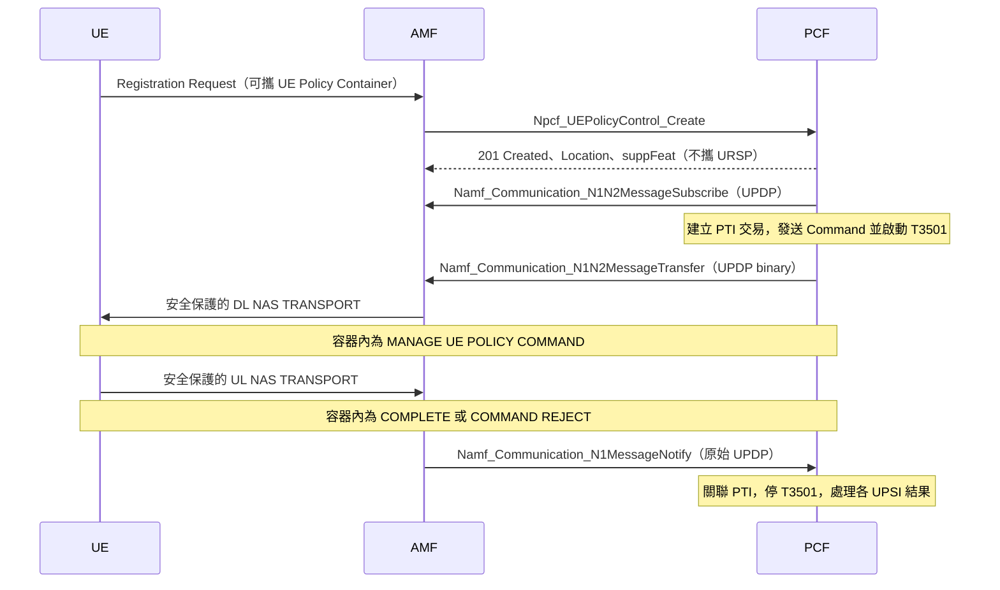

# free5GC URSP 第二階段：AMF 實作分析

原分析日期：2026-11-23（Asia/Taipei）  
設計統一更新：2026-11-24（Asia/Taipei）；本次僅更新文件並核對 R17 規範，未重新執行原始碼／實機測試。  
範圍：唯讀原始碼與 Release 17 規範分析。未修改受分析專案、未執行測試、未移植 ClaudIA 程式碼。本檔為分析結果匯出。

## 1. 結論

**free5GC AMF 已有 UE Policy 的雙向 NAS 透明轉送基礎；主要缺口為 UE Policy Association、PCF 選擇與呼叫、Registration 整合及生命週期管理。**

ClaudIA 可以參考啟動開關與註冊後下發的設計，但不能直接當作 Release 17 相容範本：

- 其 AMF 從 PCF Association Create response 取得政策；標準 PCF → AMF 下發應使用 Namf Communication。
- Complete／Reject 在 ClaudIA AMF 只記錄 log，沒有回 PCF。
- free5GC 已有 UPDP 的 N1N2 下行與 N1MessageNotify 上行；不應重寫成 AMF 自行終結 UE Policy 協定。
- PTI、T3501、政策交易重送及 Complete／Reject 語意處理由 **PCF** 負責。
- upstream free5GC PCF 的 UE Policy handlers 仍回 501，AMF 單獨修改不能完成端到端功能。

「已完整實作」只指表列子功能呼叫鏈完整，不代表已通過整體 3GPP conformance 或實機驗證。「尚未確認」不代表已證明功能不存在。

## 2. 固定分析版本

| 代號 | Repository | Commit SHA |
|---|---|---|
| C | `francurieses/claudia-5gc` | `447c6e4e7ab7c11ccd36881f988ef9f19cc06727` |
| A | `free5gc/amf` | `2b92cb75a52ca58d9a44d3cb193e34e5d6067b7d` |
| P | `free5gc/pcf` | `e953c7a7f5f46d9c51999c9f59a5f77867729d25` |
| O | `free5gc/openapi`，A 的依賴 | `7fad8e868cb23863719dea4b43db36ef54655454` |

以下程式證據全部固定至上述版本。C 的 AMF 內部路徑以 `nf/amf/internal/` 為前綴；啟動與 HTTP client 位於 `nf/amf/cmd/amf/`。

## 3. Release 17 規範與正確分工

| 規範 | 本次對照章節與用途 |
|---|---|
| [TS 23.502 V17.11.0](https://www.etsi.org/deliver/etsi_ts/123500_123599/123502/17.11.00_60/ts_123502v171100p.pdf) | §4.16.11–13：Association 建立、修改、終止；§4.2.4.3：透明 UE Policy delivery |
| [TS 23.503 V17.11.0](https://www.etsi.org/deliver/etsi_ts/123500_123599/123503/17.11.00_60/ts_123503v171100p.pdf) | §6.6.2：URSP 結構、provisioning 與 UE 規則選擇 |
| [TS 24.501 V17.15.0](https://www.etsi.org/deliver/etsi_ts/124500_124599/124501/17.15.00_60/ts_124501v171500p.pdf) | §5.4.5：NAS Transport；Annex D：UE Policy Delivery 訊息、交易與 timers |
| [TS 24.526 V17.8.0](https://www.etsi.org/deliver/etsi_ts/124500_124599/124526/17.08.00_60/ts_124526v170800p.pdf) | §5.2：URSP policy part 編碼與 UE 行為 |
| [TS 29.525 V17.9.0](https://www.etsi.org/deliver/etsi_ts/129500_129599/129525/17.09.00_60/ts_129525v170900p.pdf) | §4.2.2.1、§5.6.2：Create、Association Models、通知與欄位適用條件 |
| [TS 29.518 V17.9.0](https://www.etsi.org/deliver/etsi_ts/129500_129599/129518/17.09.00_60/ts_129518v170900p.pdf) | §5.2.2.3.1–5、§6.1：Namf Transfer、訂閱、Notify 與傳輸失敗通知 |

### 3.1 標準資料流



此圖表示邏輯資料流，不表示所有 SBI 訊息只能依圖中順序序列執行；實作必須處理 callback 與 Create response 的競態。

### 3.2 必須區分的事項

- AMF 發起 Association Create／Delete；PCF 透過 Namf 下發，AMF 透明轉送回覆。
- Create response 的 `uePolicy` 用於 H-PCF 對 V-PCF，不應作為一般 PCF → AMF 下發路徑。
- 非漫遊 AMF 不應自行把 Complete 改裝為 `uePolDelResult` 呼叫 PCF Update；相關欄位用於 V-PCF 向 H-PCF 轉報結果。
- Association 建立不等於 UE 已套用政策；URSP 亦可於 Registration 後更新，不能把 URSP 成功套用設為 Registration 成功前提。
- 等待 Registration Complete 才下發是 ClaudIA 的實作安排，並非所有註冊情境都能只依賴此事件。
- Command／Complete／Reject 的訊息定義在 **TS 24.501 Annex D**；24.526 定義 URSP policy part。
- T3501 與政策交易重送在 PCF；AMF 負責傳輸、paging、傳輸失敗通知。
- Association Delete 不代表 UE 已刪除本地儲存的 URSP。

以上亦補正第一階段分析：`uePolicy` 欄位存在且採 base64，不能據此判定 ClaudIA 整個 Create response → AMF 下發流程符合標準。

### 3.3 PCF／AMF 共用的 R17 Delivery 契約

<!-- BEGIN SHARED R17 UE POLICY DELIVERY CONTRACT -->
**共同設計基準（2026-11-24）：非漫遊 PLMN、正常註冊 UE、3GPP access。** 此範圍是首版實作與驗收限制；不代表已完成漫遊、SNPN、雙 access 或全部 Release 17 功能。下表是兩份報告共用的目標契約，並非現有程式已實作的宣告。

| 階段 | PCF 責任 | AMF 責任／介面約束 |
|---|---|---|
| Association | 建立獨立 UE Policy context；Create 回 `201 Created`、`Location`、`PolicyAssociation.suppFeat`，及適用的其他欄位 | 發起 `Npcf_UEPolicyControl_Create`；即使沒有待下發政策仍保存 Association URI；與 AM Policy 分開 |
| Create response | **對 AMF 不放入供其下發的 `uePolicy`／URSP**；該 response 欄位用於 H-PCF → V-PCF | 不從 Create response 取容器排入 NAS；不新增此路徑的 fallback |
| 回覆訂閱 | 呼叫 `Namf_Communication_N1N2MessageSubscribe`，訂閱 `UPDP` 並提供 PCF 的 N1 notification URI；保存訂閱資源 | 建立每個 UE Policy association 對應的訂閱，後續依訂閱轉送 UE 回覆 |
| 政策下發 | 產生 URSP 與 Annex D Command，經 `Namf_Communication_N1N2MessageTransfer` 下發 | 將 UPDP binary 原樣裝入受 NAS 安全保護的 `DL NAS TRANSPORT`，payload container type 為 UE policy；處理可達性、paging 與傳輸失敗 |
| 政策回覆 | 接收 `Namf_Communication_N1MessageNotify`，解碼 Complete／Reject，關聯 PTI 及各 UPSI 結果 | 從受保護的 `UL NAS TRANSPORT` 取出 UPDP，原樣以 multipart Notify 回 PCF；不終結 UE Policy 協定 |
| Policy Transaction | 管理 PTI、命令快照、T3501、重送次數、結果與過期交易；政策更新沿用 Association | 不配置政策 PTI、不跑 T3501、不決定政策重送；重新傳送時以當時 NAS context 產生受保護外框 |
| 生命週期 | Delete／termination 時停止交易與 timer，清理 Namf 訂閱及延遲工作 | 依最後 access、abort、移交等情境決定 Delete／Update，避免舊 callback 誤配新 context；Association Delete 不代表 UE 已刪除 URSP |

介面分工依 [TS 29.525 V17.9.0 §4.2.2.1、§4.2.2.2.1.0、§4.2.3.1、§5.6.2](https://www.etsi.org/deliver/etsi_ts/129500_129599/129525/17.09.00_60/ts_129525v170900p.pdf) 與 [TS 23.502 V17.11.0 §4.2.4.3、§4.16.11–13](https://www.etsi.org/deliver/etsi_ts/123500_123599/123502/17.11.00_60/ts_123502v171100p.pdf)。非漫遊 Complete／Reject 走 Namf Notify；**不由 AMF 改裝成 `uePolDelResult` 呼叫 Npcf Update**。後者是漫遊 V-PCF → H-PCF 的結果轉報；不應與 AMF 合法的 Association Update／事件回報混為一談。

**三種 callback 必須分開。** AMF 在 Create request 提供的 `notificationUri` 接收 Npcf 的 association 更新／終止通知；PCF 在 Namf Subscribe 提供的 N1 notification URI 接收 UE UPDP；PCF 在 Transfer 提供的 `n1n2FailureTxfNotifURI` 接收傳輸失敗。URI 可共用主機，但須各自有正確的路由、資料模型與關聯。Namf 使用 multipart JSON metadata＋binary N1 part，以 Content-ID 關聯，不把 Create response 的 base64 字串當成 NAS payload。[TS 29.518 V17.9.0 §5.2.2.3.1–5、§6.1](https://www.etsi.org/deliver/etsi_ts/129500_129599/129518/17.09.00_60/ts_129518v170900p.pdf)

**傳輸與政策結果分開記錄。** Create 的 201、Transfer 的 200／202、Notify 的 204 都不是 UE 套用政策的證明。PCF 須關聯 Transfer 的 Location／`n1n2MsgDataUri` 與政策交易；AMF 的同步錯誤或非同步 failure notification 交由 PCF 決定後續工作。Registration 尚在進行而暫拒 Transfer 時，須有可恢復的排程；不能在 AMF 另建政策重送器。此為依標準分工推導的實作要求。[TS 29.518 V17.9.0 §5.2.2.3](https://www.etsi.org/deliver/etsi_ts/129500_129599/129518/17.09.00_60/ts_129518v170900p.pdf)

**PCF 交易規則與驗收：**

- 發出 Command 時依 Annex D 配置可用 PTI，先建立可接收快速回覆的交易狀態，並啟動該 PTI 的 T3501；同一交易重送保留 PTI 與命令內容，不重新 Create。初版限制每 UE 一筆進行中交易是本地設計選擇，須有佇列／合併決策，不能覆寫既有交易。
- Complete 停止 T3501；Reject 亦停止 T3501，依 management result 中各 UPSI／cause 處理，未列為失敗的指令視為成功。不能把 Reject 一律當成整包失敗，或直接讀第三個 byte 作 cause。
- T3501 第 1–4 次到期重送並重啟 timer；第 5 次到期中止並釋放 PTI。傳輸失敗 response／notification 必須停止受影響交易的監督 timer；恢復可達性後的補送與 T3501 到期重送分開處理。
- Complete／Reject 後不立即重用 PTI；保留至少一個預設 T3501 期間是規範列出的實作方式。未知／保留 PTI 依 Annex D 忽略，重複／遲到回覆不得完成另一筆交易。
- PCF 與 UE 的政策處理成功仍須與實際依 URSP 選擇 PDU Session 分層驗證；AMF 不保存「URSP 已套用版本」作為成功判準。

以上依 [TS 24.501 V17.15.0 Annex D.1.2、D.2.1.2–5、D.5–D.6、D.8.3](https://www.etsi.org/deliver/etsi_ts/124500_124599/124501/17.15.00_60/ts_124501v171500p.pdf)。URSP policy part 依 TS 24.526 §5.2；NAS transport 依 TS 24.501 §5.4.5。

**時序限制：** Subscribe 必須在可能收到 UE 回覆前就緒；PCF／AMF 須能承受 Create response 前後的反向 SBI 呼叫，不持有 UE lock 等待 callback。圖示順序不構成規範要求的全序；Registration Complete 也不是所有 registration update 的唯一觸發點。可先驗證非漫遊閉環，漫遊另設 H-PCF／V-PCF 及 PTI mapping 測試，不沿用非漫遊假設。
<!-- END SHARED R17 UE POLICY DELIVERY CONTRACT -->

對應 PCF 方案見[PCF 分析第 5.1、8 節](claudia-free5gc-pcf-ue-policy-analysis.md)。

## 4. ClaudIA AMF 實際流程

| 項目 | 原始碼與實際行為 | 規範判定／free5GC 是否修改 |
|---|---|---|
| ON／OFF | C `cmd/amf/main.go`，`main()` 359–366：決定是否建立 client、`WithPCF()`；`urspEnabledFromEnv()` 1517–1529：環境變數優先，其次 YAML，省略預設 ON | 部署選擇。free5GC 應新增預設 OFF。[啟動](https://github.com/francurieses/claudia-5gc/blob/447c6e4e7ab7c11ccd36881f988ef9f19cc06727/nf/amf/cmd/amf/main.go#L359)、[設定解析](https://github.com/francurieses/claudia-5gc/blob/447c6e4e7ab7c11ccd36881f988ef9f19cc06727/nf/amf/cmd/amf/main.go#L1517) |
| Association 建立時機 | `Phase3_ProcessSMCComplete()` 呼叫 `runOptionalPeers()`，`registration.go:1127–1137`；後者於 1814–1819 呼叫 Create；1283–1296 儲存 ID 與 pending | SMC Complete 後建立是實作安排；free5GC 需新增整合。[來源](https://github.com/francurieses/claudia-5gc/blob/447c6e4e7ab7c11ccd36881f988ef9f19cc06727/nf/amf/internal/procedures/registration.go#L1276) |
| AMF → PCF | `HTTPPCFClient.CreateUEPolicyAssociation()`，`clients.go:1959–1985` POST `/npcf-ue-policy-control/v1/policies`，body 只有 SUPI、字串 servingPlmn | 不完整：缺 notificationUri、suppFeat；servingPlmn 應為物件。free5GC 使用標準 Models。[來源](https://github.com/francurieses/claudia-5gc/blob/447c6e4e7ab7c11ccd36881f988ef9f19cc06727/nf/amf/cmd/amf/clients.go#L1959) |
| PCF 提供容器 | `handleCreateUEPolicy()`，`nf/pcf/internal/server/n15.go:85–133`：取規則、Encoder、儲存、回 Location／base64 uePolicy | 有資料流，但對 AMF 的用法不符合標準 Namf 分工，不宜移植。[來源](https://github.com/francurieses/claudia-5gc/blob/447c6e4e7ab7c11ccd36881f988ef9f19cc06727/nf/pcf/internal/server/n15.go#L85) |
| AMF 接收容器 | `CreateUEPolicyAssociation()`，`clients.go:1992–2024`：解析 Location、uePolicy，另有 legacy fallback；base64 decode | 解碼存在，但不能據此認定 API 使用情境合規。[來源](https://github.com/francurieses/claudia-5gc/blob/447c6e4e7ab7c11ccd36881f988ef9f19cc06727/nf/amf/cmd/amf/clients.go#L1992) |
| 註冊後下發 | Registration Complete 處理，`nas.go:1258–1277`：取出、清除 pending，再 `SendUEPolicyContainer()` | 此時機是設計選擇。free5GC 必須考慮不走 Complete 的註冊情境。[來源](https://github.com/francurieses/claudia-5gc/blob/447c6e4e7ab7c11ccd36881f988ef9f19cc06727/nf/amf/internal/nas/nas.go#L1258) |
| DL NAS／安全 | `SendUEPolicyContainer()`，`nas.go:3988–4035`：UE Policy payload → `sendNASSecured()`；1608–1669：cipher、MAC、COUNT | 基本方向與保護外框正確；free5GC 可重用自身既有能力。[下發](https://github.com/francurieses/claudia-5gc/blob/447c6e4e7ab7c11ccd36881f988ef9f19cc06727/nf/amf/internal/nas/nas.go#L3988)、[安全](https://github.com/francurieses/claudia-5gc/blob/447c6e4e7ab7c11ccd36881f988ef9f19cc06727/nf/amf/internal/nas/nas.go#L1608) |
| Complete／Reject | `nas.go:2943–2944` dispatch；`handleUEPolicyDelivery():3216–3256` 讀 PTI、type，只 log，未回 PCF | 未完成標準閉環。free5GC 應透明 Notify。[來源](https://github.com/francurieses/claudia-5gc/blob/447c6e4e7ab7c11ccd36881f988ef9f19cc06727/nf/amf/internal/nas/nas.go#L3216) |
| 手動更新 | `main.go:912–955` push handler → `FetchUEPolicyContainer():27–46` → 再 Create → 覆寫 ID → 下發 | 自訂管理流程，非標準 PCF 主動更新。本階段不需新增。[handler](https://github.com/francurieses/claudia-5gc/blob/447c6e4e7ab7c11ccd36881f988ef9f19cc06727/nf/amf/cmd/amf/main.go#L912)、[Fetch](https://github.com/francurieses/claudia-5gc/blob/447c6e4e7ab7c11ccd36881f988ef9f19cc06727/nf/amf/internal/procedures/uce.go#L27) |
| Deregistration／abort | UE dereg：nas.go 2753–2760；`releasePCFAssociations()`，udm_dereg.go 257–279；`ReleaseUERegistration()`，reg_abort.go 26–55；`ReleasePCFPolicy()`，registration.go 1732–1736 → Delete client | 已有刪除鏈，補償不足。free5GC 需獨立 UE Policy cleanup。[network dereg](https://github.com/francurieses/claudia-5gc/blob/447c6e4e7ab7c11ccd36881f988ef9f19cc06727/nf/amf/internal/nas/udm_dereg.go#L257)、[abort](https://github.com/francurieses/claudia-5gc/blob/447c6e4e7ab7c11ccd36881f988ef9f19cc06727/nf/amf/internal/procedures/reg_abort.go#L26)、[Delete](https://github.com/francurieses/claudia-5gc/blob/447c6e4e7ab7c11ccd36881f988ef9f19cc06727/nf/amf/internal/procedures/registration.go#L1732) |

### 4.1 已確認的缺陷與未完成事項

1. **無政策容器時遺失已建立的 Association ID。** `registration.go:1283–1296` 只有容器非空才記錄 ID；合法的「建立成功但無政策」仍應保留 Association。
2. **手動 push 可能累積孤兒 Association。** `uce.go:42` 每次 Create；`main.go:941–944` 覆寫舊 ID，該鏈未先刪舊 Association。
3. **pending 在成功前清除。** `nas.go:1264–1269` 先清除再傳送，失敗僅 log。`SendUEPolicyContainer():4001–4007` 對 CM-IDLE 只回錯誤，該函式未建立 paging／補送工作；不能把 deferred log 當成可靠重送證據。
4. **Reject cause 解碼錯誤。** `nas.go:3242–3244` 使用 `container[2]`；標準兩個 header octet 後是 LV-E management result，包含長度與各 UPSI 結果，不能直接取第三個 byte。依 TS 24.501 D.5.3。
5. **URSPVersion 不是套用成功。** `nas.go:4021` 在 sender 呼叫前遞增；與 [context.go:367–375](https://github.com/francurieses/claudia-5gc/blob/447c6e4e7ab7c11ccd36881f988ef9f19cc06727/nf/amf/internal/context/context.go#L367) 註解不一致。
6. **Delete 失敗仍清空 ID。** `udm_dereg.go:271–279` 缺少補償依據。
7. **PCF 交易未閉環。** Complete／Reject 未回傳，無法據此證明 PTI、T3501 與交易重送完成。

ClaudIA [dev.yaml:9–19](https://github.com/francurieses/claudia-5gc/blob/447c6e4e7ab7c11ccd36881f988ef9f19cc06727/nf/amf/config/dev.yaml#L9) 仍設 `ursp_enabled: false` 並保留 OTA／Encoder 長度問題警告。**本階段未取得原始封包，實機根因與修復狀態尚未確認。**

## 5. free5GC AMF 現有能力

| 功能 | 分類 | 實際程式證據 | 合規判定／修改需求 |
|---|---|---|---|
| UE Policy Association Context | 尚未實作 | `internal/context/amf_ue.go:126–130` 的 PolicyAssociationId 配對 AmPolicyAssociation；`RemoveAmPolicyAssociation():916–918` 清除此 ID | 現有欄位屬 AM Policy，不可誤用；需新增獨立 context。[來源](https://github.com/free5gc/amf/blob/2b92cb75a52ca58d9a44d3cb193e34e5d6067b7d/internal/context/amf_ue.go#L126) |
| UEPolCtrl Consumer | 尚未實作 | `internal/sbi/consumer/pcf_service.go`，`AMPolicyControlCreate():47–106` 使用 AMPolCtrl client／scope | 需新增 UEPolCtrl consumer、discovery、scope。[來源](https://github.com/free5gc/amf/blob/2b92cb75a52ca58d9a44d3cb193e34e5d6067b7d/internal/sbi/consumer/pcf_service.go#L47) |
| Connected N1N2 下發 | 基本子流程已完整實作 | `N1N2MessageTransferProcedure()`，`internal/sbi/processor/n1n2message.go:121–141` UPDP mapping；251–269 build NAS／NGAP 發送 | 方向正確，可重用；需 association 整合。[來源](https://github.com/free5gc/amf/blob/2b92cb75a52ca58d9a44d3cb193e34e5d6067b7d/internal/sbi/processor/n1n2message.go#L121) |
| N1 回覆訂閱 | 基本子流程已完整實作 | 同檔 `N1N2MessageSubscribeProcedure():533–565` 配置 ID、儲存 subscription | 非 stub；需 PCF 真正訂閱及生命週期整合。[來源](https://github.com/free5gc/amf/blob/2b92cb75a52ca58d9a44d3cb193e34e5d6067b7d/internal/sbi/processor/n1n2message.go#L533) |
| UL UE Policy 回 PCF | 部分實作，透明轉送已存在 | `HandleULNASTransport()`，`handler.go:49–71` → `SendN1MessageNotify()`，notifier/n1n2message.go 50–88，依 class／URI 送 multipart | 可轉送 Complete／Reject；無訂閱不送。需補整合與錯誤可觀測性。[UL](https://github.com/free5gc/amf/blob/2b92cb75a52ca58d9a44d3cb193e34e5d6067b7d/internal/gmm/handler.go#L49)、[Notify](https://github.com/free5gc/amf/blob/2b92cb75a52ca58d9a44d3cb193e34e5d6067b7d/internal/sbi/processor/notifier/n1n2message.go#L50) |
| DL NAS／安全 | 基本子流程已完整實作 | `BuildDLNASTransport():30–59` → `nas_security.Encode(...protectedAndCiphered)`；Encode 13–89 無 context 時不允許此訊息降明文 | 可重用，不需重寫加密。[Build](https://github.com/free5gc/amf/blob/2b92cb75a52ca58d9a44d3cb193e34e5d6067b7d/internal/gmm/message/build.go#L30)、[Encode](https://github.com/free5gc/amf/blob/2b92cb75a52ca58d9a44d3cb193e34e5d6067b7d/internal/nas/nas_security/security.go#L13) |
| UL 安全 | 基本子流程已完整實作 | `Decode()` → `validateUplinkSecurity()`，security.go 295–304 要求 context、protected-and-ciphered、MAC；UL handler 54–55 檢查 MacFailed | 維持原安全入口，不繞過。[來源](https://github.com/free5gc/amf/blob/2b92cb75a52ca58d9a44d3cb193e34e5d6067b7d/internal/nas/nas_security/security.go#L295) |
| Idle／paging／恢復 | 部分實作 | `N1N2MessageTransferProcedure():386–416`；handler.go 2161–2173 Service Request UPDP；1045–1057 registration update pending | 有基礎，仍需 URSP 失敗、競態、access 測試。[paging](https://github.com/free5gc/amf/blob/2b92cb75a52ca58d9a44d3cb193e34e5d6067b7d/internal/sbi/processor/n1n2message.go#L386)、[恢復](https://github.com/free5gc/amf/blob/2b92cb75a52ca58d9a44d3cb193e34e5d6067b7d/internal/gmm/handler.go#L2161) |
| Registration Association 整合 | 尚未實作 | `HandleInitialRegistration():774 起`；handler.go 872–885 選擇 AM Policy service 並建立 AM Association | 需獨立發現 UE Policy service，不能直接沿用 AM URI。[來源](https://github.com/free5gc/amf/blob/2b92cb75a52ca58d9a44d3cb193e34e5d6067b7d/internal/gmm/handler.go#L872) |
| Deregistration／cleanup | 尚未整合 UE Policy | `HandleDeregistrationRequest():2701–2717`、`RemoveAmfUe():13–40` 僅刪 AM Policy；`AmfUe.Remove():425–475` 本地移除 | 需 UE Policy cleanup，區分最後 access 與移交。[dereg](https://github.com/free5gc/amf/blob/2b92cb75a52ca58d9a44d3cb193e34e5d6067b7d/internal/gmm/handler.go#L2701)、[cleanup](https://github.com/free5gc/amf/blob/2b92cb75a52ca58d9a44d3cb193e34e5d6067b7d/internal/gmm/common/user_profile.go#L13) |

### 5.1 現有路徑限制

- `SendN1MessageNotify()` 用 `context.Background()`；失敗僅 log，未向上回傳；無訂閱亦無結果回報。
- UPDP 分支沿用預設 3GPP access，不能據此宣稱完整支援只在 non-3GPP reachable 的 UE。
- `N1N2MessageTransferProcedure():203–209` 在 Registration ongoing 回暫時拒絕。PCF 若在 Create 過程立即下發，必須處理時序。
- `HandleRegistrationComplete():2593–2596` 可能立刻釋放 N2。**不能只在該 handler 最後新增發送。**[來源](https://github.com/free5gc/amf/blob/2b92cb75a52ca58d9a44d3cb193e34e5d6067b7d/internal/gmm/handler.go#L2593)

### 5.2 PCF 必要依賴

P `internal/sbi/api_uepolicy.go` 的 Create／Read／Update／Delete handlers **47–60** 全部直接回 HTTP 501，未接業務流程。[固定版本證據](https://github.com/free5gc/pcf/blob/e953c7a7f5f46d9c51999c9f59a5f77867729d25/internal/sbi/api_uepolicy.go#L47)

因此僅完成 AMF 不能讓現行 upstream PCF 端到端工作。

## 6. 功能差異表

本表證據見第 4、5 節固定版本呼叫鏈。

| 功能 | ClaudIA | free5GC AMF |
|---|---|---|
| URSP 開關 | 有，省略預設 ON；dev YAML OFF | 無 |
| 獨立 UE Policy Association ID | 有 | 無；近似名稱欄位屬 AM Policy |
| Registration 建立 Association | 有自訂流程 | 無 |
| 標準 Create request | 不完整 | 未接入 |
| PCF → AMF 標準 Namf 下發 | 所追蹤 URSP 路徑用 Create response | 有 UPDP N1N2 接收與 NAS 轉送 |
| DL NAS UE Policy／安全 | 有 | 有 |
| Complete／Reject 回 PCF | 僅 log，未閉環 | 有依訂閱 Notify 基礎 |
| 閒置 UE 下發 | 該發送路徑回錯誤 | 有 generic paging／恢復 |
| 政策更新 | 自訂 push，每次 Create | generic 下行存在，缺 PCF 整合 |
| 政策交易重送 | 未形成 PCF 閉環 | AMF 傳輸基礎存在；PCF 業務缺失 |
| Association Delete | 有基本鏈，補償不足 | UE Policy 未整合 |

## 7. URSP ON／OFF 設計

建議置於既有 AMF `configuration`：

```yaml
configuration:
  ursp:
    enabled: false
```

局部設定即為：

```yaml
ursp:
  enabled: false
```

以下為建議行為，尚未實作。

| 情況 | 行為 |
|---|---|
| 省略／OFF | 不進新增 discovery、UE Policy Create、背景補送；保留原 Registration 與既有 generic NAS／Namf handler |
| ON | 對適用正常註冊 UE 建立或沿用 Association，接入 PCF 訂閱與下發 |
| Create 成功但無政策 | 仍儲存 resource URI／ID，不強制每次註冊都下發 |
| PCF 不可用／501／timeout | 選用 URSP 不無限阻塞 Registration；明確記錄狀態、有限重試 |
| UE 未帶容器 | 不直接推定不支援；ON 可作本地建立決策，政策由 PCF 決定 |
| UE 無回應／Reject | AMF 轉送結果或通知傳輸失敗，PCF 管交易，不令 Registration 失敗 |
| AMF 重啟 | 重建／恢復 Association 與 N1 訂閱，不重播舊加密 NAS PDU |
| 重啟後 OFF | 停止新增流程，仍允許獨立清理可識別舊 Association |

### 7.1 開關放置

- AMF `ursp.enabled` 控制此 AMF 的新增整合。
- PCF 另設自己的 URSP provisioning 開關，控制規則產生與交易生命週期；PCF 可能服務多個 AMF。
- OFF 是部署功能限制，不能宣稱該模式完整提供 UE Policy 標準能力。
- OFF 或 Delete 不會自動撤回 UE 已儲存 URSP。
- 不發明單一 URSP-support 布林值，也不把 ANDSP support 當成 URSP support；保留實際容器與能力給 PCF。

## 8. 建議修改檔案

以下為提案，尚未修改。新增檔名是建議命名。

| 檔案 | 修改內容 |
|---|---|
| AMF `pkg/factory/config.go` | 可選 URSP 設定、getter、驗證，預設 false。現有 Configuration 79–119。[入口](https://github.com/free5gc/amf/blob/2b92cb75a52ca58d9a44d3cb193e34e5d6067b7d/pkg/factory/config.go#L79) |
| AMF `internal/context/context.go` | `InitAmfContext():117 起` 接入設定 |
| AMF `internal/context/amf_ue.go` | 獨立 UE Policy PCF ID／service URI、Association URI、狀態與協商結果 |
| AMF 新增 `internal/sbi/consumer/ue_policy_service.go` | UEPolCtrl Create／Update／Delete、正確 scope、timeout、Location 驗證 |
| AMF `internal/sbi/consumer/consumer.go` | 初始化 client cache 與同步 |
| AMF `internal/gmm/handler.go` | Registration、原始 UE Policy Container、註冊後 N2 時序、deregistration |
| AMF `internal/gmm/sm.go` | registered 狀態邊界的後續工作，不只依賴 Registration Complete |
| AMF 新增 `internal/sbi/api_uepolicy_callback.go` | UE Policy UpdateNotify／termination callback，與 N1 payload 接收分開 |
| AMF `internal/sbi/api_httpcallback.go` | 路由與 UDM deregistration cleanup |
| AMF `internal/sbi/processor/n1n2message.go` | 重用 UPDP；association 狀態、競態、access 選擇 |
| AMF `internal/sbi/processor/notifier/n1n2message.go` | Notify timeout、結果與失敗可觀測性；保留原始 payload |
| AMF `internal/gmm/common/user_profile.go` | 集中 cleanup，區分真正移除與移交 |
| AMF `internal/sbi/processor/callback.go`、`ue_context.go` | network deregistration、AMF relocation、PCF reselect |
| 主 free5GC `config/amfcfg.yaml` | 預設 OFF 範例；不屬本次固定 AMF repo，實作時另固定版本 |

`internal/gmm/message/build.go` 與 `internal/nas/nas_security/security.go` 優先重用，以測試驗證，不為 URSP 另寫加密／MAC。

PCF 最少另需：

- 完成 PCF 報告第 8 節的 Association 業務；非漫遊 Create response 不帶下發用 `uePolicy`。
- Namf UPDP 訂閱與下發 client。
- N1MessageNotify 接收與 Complete／Reject 處理。
- PTI、T3501、交易狀態與重送。
- Delete 停止交易並清理訂閱。

本階段不新增 Webconsole 即時更新、不修改 SMF、UPF 或 free-ran-ue。

## 9. 最小實作順序

1. **開關與 OFF 回歸**：省略／OFF 無新增 SBI 或政策 NAS，原註冊行為一致。
2. **Association context 與 consumer**：獨立 discovery；Create 成功即保存 URI，即使無政策。
3. **Registration 整合**：轉交原始容器／uePolReq、排除 emergency、避免重複 Create。
4. **PCF Subscribe → Transfer → DL NAS**：重用 UPDP、安全編碼與 NGAP，處理 registration ongoing 暫時拒絕。
5. **UL → Notify → PCF 結果**：原樣回傳 Complete／Reject，PCF 解碼與 PTI 關聯，AMF 不寫 URSP parser。
6. **Delete 與補償**：最後 access deregister、network deregistration、abort、cleanup／移交皆有明確決策。
7. **Idle、timeout、重啟**：PCF T3501、AMF 傳輸失敗通知與本地補償，完成整合測試。

不建議先採 Create response 取容器作為最小版本，因為後續必須更換核心標準資料流。

## 10. 必要測試

以下為待新增測試，本次未執行。

| 類別 | 案例／驗收 |
|---|---|
| 設定 | 省略、OFF、ON、非法型別；舊 YAML 可啟動 |
| OFF 回歸 | 無新增 discovery／Create／政策 NAS；原 Registration、timeout、釋放一致 |
| Create request | 必填、servingPlmn 物件、servingNfId、scope、容器位元組一致 |
| Create response | 201／Location／suppFeat；非漫遊不含下發用 uePolicy；無政策仍存 Association；錯 Location、4xx／501／5xx／timeout 不假成功 |
| 註冊競態 | Create 前後 Subscribe／Transfer；暫時拒絕後恢復；不持 UE lock 等反向 callback |
| DL NAS | UPDP → UE Policy；容器不變、無 PDU Session ID；header、COUNT、MAC／cipher |
| UL NAS | Complete／Reject 原樣 multipart 回 PCF；無訂閱、timeout／錯誤可觀測 |
| 安全負面 | 無 context、plain UL、錯 MAC、重放 COUNT 不進轉送 |
| PCF 交易 | 正確／錯誤／重複／遲到 PTI、多 UPSI Reject／部分成功；T3501 第 1–4 次重送、第 5 次中止；Complete／Reject／傳輸失敗停 timer |
| 傳輸與協定隔離 | 200／202 不標記 UE 套用；202 Location 與 failure notification 關聯；AMF 不跑 T3501、不把回覆轉成 uePolDelResult Update |
| Idle | paging 成功恢復 UPDP；失敗通知；其他 N1N2 不覆寫或遺失政策 |
| Deregistration | 最後 access 才刪；單 access 不誤刪；重複清理、404、Delete timeout |
| Cleanup／重啟 | abort、UDM network dereg、context 取代、重啟訂閱；舊狀態不錯配新 UE |
| 整合 | 測試 PCF／UE peer：Create → Subscribe → Transfer → protected NAS → Complete／Reject → Notify → Delete |
| 併發 | 多 UE、同 UE 註冊／deregister 競態，相關 go test -race |

不修改 free-ran-ue 時，可用測試 peer 驗證 SBI／NAS 閉環；這不能代替真實 UE 套用 URSP 的驗證。

## 11. 相容性與尚未確認

- **PCF 尚缺功能**：固定版本 UE Policy handlers 為 501。
- **設備差異**：收到 Command、回 Complete、依 URSP 選 PDU Session 是不同驗收層次。
- **Registration Complete**：不是所有 registration update 的通用觸發點。
- **雙 access**：Association 是 UE 層級，不能每個 access 任意建立／刪除。
- **漫遊／SNPN**：H-PCF／V-PCF、HPLMN／serving PLMN、UPSI 不可混用。首版若只驗非漫遊 3GPP access，須標示範圍。
- **大容器**：NAS 欄位上限不等於 RAN 實際可承載量，PCF 處理政策分割，AMF 不截斷。
- **開關**：OFF 不撤回 UE 已存政策。
- **OAuth**：Notify helper 所列呼叫點未建立 token context，跨 NF 通知需驗證。
- **尚未確認**：實機 OTA、ClaudIA 設定警告根因、完整跨 NF 重啟恢復，以及提案在目標部署版本的測試結果。

## 12. 不複製 GPL 的實作原則

後續依規範與 free5GC 既有介面獨立撰寫，不移植 ClaudIA 函式、decoder 或測試程式碼。保留條文與自行推導測試向量作為設計依據。

本次已閱讀 ClaudIA 原始碼，因此不應把後續工作描述成正式 clean-room 隔離。
