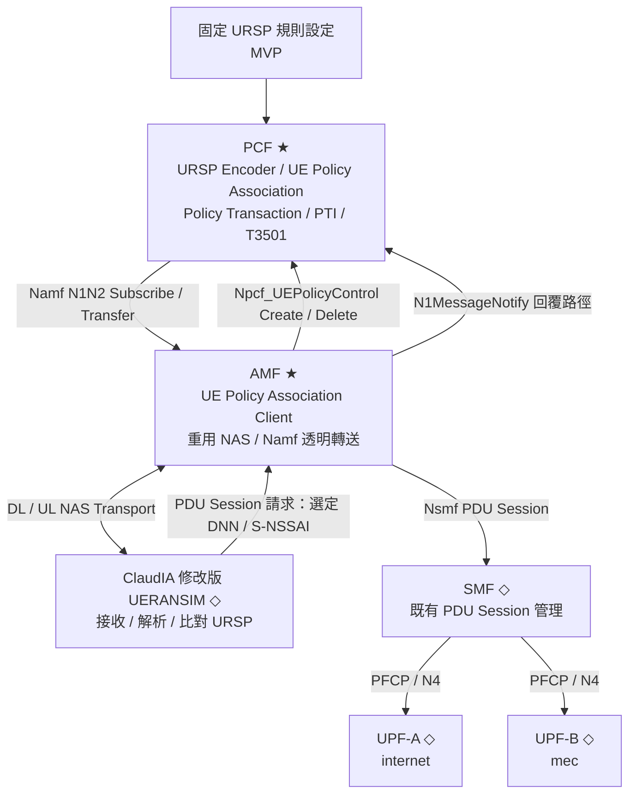
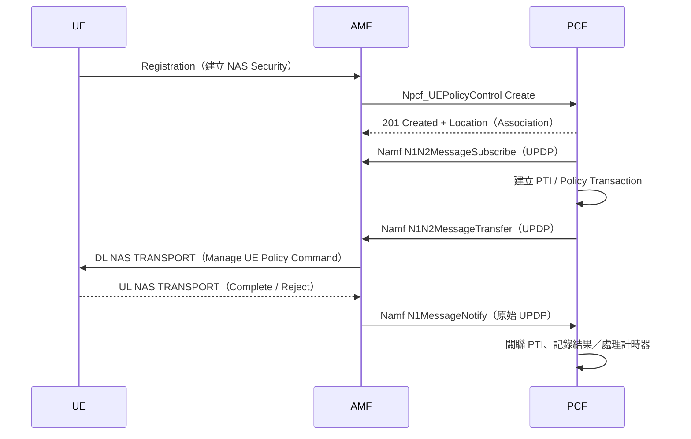

# Final Project Proposal：free5GC URSP 功能實作與多 PDU Session 選擇驗證

> 原提案：2026-11-21｜修訂：2026-11-24  
> 方向：5G Source Track（功能補齊與 CI 測試）  
> 狀態：設計提案；尚未宣稱完成跨 NF 端到端驗證

## 1. 組別資訊

- **組名**：（待填）
- **組長**：（待填）
- **組員**：（待填）
- **題目**：在 free5GC 補齊可啟用／停用的 URSP，驗證 UE 依策略選擇不同 PDU Session。

## 2. 背景與動機

5G 支援同一個 UE 同時建立多個 PDU Session。URSP（UE Route Selection Policy）由 PCF 提供策略，UE 依據 Traffic Descriptor（流量比對條件）及 Route Selection Descriptor（路由選擇描述），選擇適合的 DNN、S-NSSAI 與 PDU Session。例如一般服務使用 `internet` DNN，特定服務使用 `mec` DNN。

依目前固定版本的原始碼分析，free5GC **尚未完成 URSP 所需的完整 UE Policy Control 流程**：

- **PCF**：`Npcf_UEPolicyControl` 的 Create／Read／Update／Delete Handler 已註冊，但在分析版本中均回傳 HTTP 501；缺乏 Association 業務、URSP 編碼及政策交易管理。
- **AMF**：已有 UE Policy Container 的 N1N2 下行、上行通知及 NAS 安全轉送基礎；尚缺獨立的 UE Policy Association、PCF 選擇與呼叫，以及註冊、清理生命週期整合。
- **UE 測試**：預計優先使用 ClaudIA 5GC 修改版 UERANSIM 驗證 URSP；與 free5GC 的相容性尚待實測，現階段不修改 `free-ran-ue`。
- **CI**：需要新增 URSP ON／OFF、交易處理與跨 NF 的整合／端到端測試。

本專題希望以符合 3GPP Release 17 的資料流補齊 free5GC，**先證明政策可下發、UE 可回覆並依規則選擇 PDU Session**，再視時間擴充真正的應用流量自動分流。

## 3. 目標與範圍

### 3.1 必要目標（MVP）

1. 在 PCF、AMF 加入**預設關閉**的 URSP 設定開關，關閉時維持原有功能。
2. PCF 支援固定 URSP 規則、符合規範的編碼，以及 UE Policy Association Create／Delete。
3. AMF 在適當時機建立／清理 UE Policy Association，重用既有 Namf 與 NAS 透明轉送能力。
4. PCF 經 **Namf Communication** 下發 `MANAGE UE POLICY COMMAND`；UE 的 Complete／Reject 經 AMF 原樣通知 PCF。
5. PCF 管理基本政策交易狀態（PTI、回覆關聯、T3501／逾時與必要重送），避免把「訊息已送出」誤判為「UE 已套用」。
6. 在 `ci-test` 增加 URSP 的 OFF 回歸、API／NAS 整合與可獨立執行的 E2E 測試。
7. 若 ClaudIA UE 相容性驗證成功，展示同一 UE 依 URSP 選擇並建立 `internet`／`mec` 兩條 PDU Session。

### 3.2 本階段不修改

- **`free-ran-ue`**：保留既有回歸測試，不在本專題增加 URSP Parser。
- **SMF／UPF 核心程式**：優先沿用既有 PDU Session、DNN／S-NSSAI 與 PFCP 功能；雙 UPF 路徑仍須實測與設定。
- **AF**：不納入本次架構與實作。

### 3.3 進階功能（非必要驗收）

真實 App 流量自動分流、Webconsole 即時更新 URSP、UDR 動態政策來源、Grafana 視覺化，以及 SMF 以 Dijkstra／link cost 選擇 UPF 路徑。Dijkstra 屬於獨立的 UPF 路徑最佳化，不是 URSP 必要條件。

## 4. 系統架構與標準流程

### 4.1 架構圖



`★`：預計新增或整合；`◇`：沿用現有功能或需驗證的外部元件。圖示為邏輯關係；實際使用者資料經 gNB／N3 到 UPF，不是經 AMF 傳送。

### 4.2 URSP 下發時序（非漫遊 MVP）



**標準分工**：AMF 建立 UE Policy Association；非漫遊情境的 PCF 不應依賴 Create Response 中的 `uePolicy` 直接交給 AMF 下發，而應使用 Namf Communication。AMF 不解讀 URSP 或自行判斷 Complete／Reject 的政策結果；這些由 PCF 管理。圖示省略註冊期間的時序競態、Paging 及失敗補償，實作需另行處理。

## 5. 預計實作內容

| 元件 | 必要工作 | 重用／界線 |
| --- | --- | --- |
| **PCF** | 固定 YAML 規則、URSP Encoder、UE Policy Association Create／Delete、Namf Subscribe／Transfer、PTI／T3501 與回覆處理 | 使用 free5GC 既有 OpenAPI Models；不照搬 ClaudIA 自訂 API 格式 |
| **AMF** | `ursp.enabled`、UE Policy PCF discovery／consumer、Association Context、Registration 與 Deregistration 整合、必要失敗處理 | 重用既有 UPDP N1N2／N1MessageNotify、NAS Security；不另寫 URSP Decoder |
| **ClaudIA UE** | 確認可接 free5GC，驗證 `ursp-show`、`ursp-match`、`ursp-establish` 及 Complete／Reject | 僅作外部測試工具，先不直接移植 GPL 原始碼 |
| **ci-test** | 新增 ON／OFF、API、NAS、Policy Transaction、E2E 測試 | 保留原有 free-ran-ue 測試 |
| **SMF／UPF** | 設定並驗證雙 DNN／雙 UPF，以及兩條 Session 的連線情況 | 原則上不修改核心程式 |

### URSP 開關設計

預計在 PCF、AMF 各加入相互獨立的設定，預設為 `false`（以下是**新增設計**，不是現有 free5GC 欄位）：

```yaml
configuration:
  ursp:
    enabled: false
```

- **OFF**：不啟動新增的 UE Policy Association／政策交易與下發；原 Registration、其他 PCF 政策服務及通用 Namf／NAS 機制照常運作。
- **ON**：對適用 UE 啟動 UE Policy Association 與下發；Create 失敗、PCF 不可用或 UE Reject 不應無限阻塞 Registration。
- **MVP 切換**：修改設定並重啟 NF；不要求無重啟即時切換。
- **注意**：關閉開關或刪除 Association，**不等於 UE 已刪除本地 URSP**；重啟及清理舊狀態需另外處理。

## 6. 測試計畫與驗收標準

| 層級 | 測試項目（預計新增） | 驗收證據 |
| --- | --- | --- |
| Unit Test | URSP Encoder 正確格式／長度、非法欄位、雙規則、不同 MNC、PTI 狀態 | 自行推導測試向量、Go test 結果 |
| Integration | UE Policy Create／Delete、標準必填欄位、Location、錯誤回覆 | HTTP status、Association 儲存／清理紀錄 |
| Integration | PCF → Namf → AMF 下發；AMF → PCF Notify | NAS／SBI trace，容器位元組一致 |
| Integration | Complete／Reject、PTI 不符、逾時／T3501、必要重送 | PCF 交易狀態與計時器紀錄 |
| Regression | `ursp.enabled=false` 或省略欄位 | 原註冊／PDU Session 正常，未新增政策下發 |
| E2E | ClaudIA UE 註冊、URSP 接收、回覆、規則比對 | UE log、`ursp-show`、NAS 封包 |
| E2E | 依 URSP 建立 `internet`、`mec` PDU Session | 兩條 Session 的 DNN／S-NSSAI 與資料路徑證據 |

建議將 ClaudIA UE 測試設成**獨立 CI job**，與原本 free-ran-ue Regression 分開。若 ClaudIA 與 free5GC 尚未相容，先以模擬 peer 完成 SBI／NAS 整合測試，不能把它當成真正 UE 已套用 URSP 的證明。

### Demo 分層

**必要展示（MVP）**：URSP OFF 正常註冊；URSP ON 建立 Association；PCF 經 Namf／AMF 下發；UE 收到並回覆；PCF 能追蹤 Complete／Reject；`ci-test` 可重複驗證。

**擴充展示**：ClaudIA UE 根據 URSP 建立兩條不同 DNN 的 PDU Session，透過 `tcpdump`／日誌確認各自的 UPF 路徑。只有觀察到應用封包自動依規則切換 Session，才能宣稱完成「真實 App 流量自動分流」。

## 7. 進度規劃與分工

| 期間 | 工作 |
| --- | --- |
| **11/21–11/30** | Proposal、固定 PCF／AMF 分析基準、ClaudIA UE 連線相容性 PoC、準備雙 DNN／雙 UPF 環境 |
| **12/1–12/7** | PCF Association／Encoder／交易邏輯與 AMF Consumer／開關／轉送整合；同步撰寫 Unit／Integration Tests |
| **12/8–12/11** | 串接 UE 與 `ci-test` E2E；執行 ON／OFF Regression；排除時序與 NAS 問題；收集 Demo 證據 |
| **12/12–12/14** | 完成簡報、操作腳本及備案影片；有餘裕再進行多 Session 分流與進階功能 |

**2～3 人分工建議**：PCF／URSP Encoder 與交易；AMF／UE Policy Association 與 NAS；ClaudIA UE 相容性、`ci-test` 及 Demo。若只有兩人，第三項由兩人共同負責。跨 NF 的 API 契約與整合測試共同審查。

## 8. 風險與備案

1. **ClaudIA 相容性**：其 UE 宣稱能解析 URSP，但尚未證明可與 free5GC 新流程互通。備案是先以測試 peer 驗證 SBI／NAS 閉環，另保留 UE 互通為明確未完成項。
2. **編碼規範差異**：ClaudIA 曾留下 URSP 長度欄位疑慮；不可直接複製 Encoder 或只依 ClaudIA 的 Golden Vector 判斷合規。應依 TS 24.501、TS 24.526 自行建立測試。
3. **Registration 競態**：Create 與 PCF 回呼可能交錯，註冊期間 N1N2 Transfer 亦可能暫時無法下發。須處理重試、時序與傳輸失敗。
4. **開關與相容性**：OFF 不應破壞原本服務；ON 時 PCF 失敗不可使正常 UE 註冊永久卡住。
5. **雙 UPF 路徑**：即使兩條 PDU Session 建立成功，也不代表必定使用不同 UPF；需明確配置拓撲並由封包證據驗證。
6. **時間與授權**：不直接移植 ClaudIA 的 GPL 程式碼至 free5GC；優先以最小可驗證功能完成專題，再擴大範圍。

## 9. 參考資料

### 專案分析與程式碼

- [本專題 PCF 分析](https://github.com/AllenHung123/free5gc-ursp/blob/main/docs/pcf-analysis.md)（2026-11-24 統一設計）
- [本專題 AMF 分析](https://github.com/AllenHung123/free5gc-ursp/blob/main/docs/amf-analysis.md)（2026-11-24 統一設計）
- [free5GC PCF](https://github.com/free5gc/pcf)、[AMF](https://github.com/free5gc/amf)、[SMF](https://github.com/free5gc/smf)、[ci-test](https://github.com/free5gc/ci-test)
- [ClaudIA 5GC](https://github.com/francurieses/claudia-5gc)、[free-ran-ue](https://github.com/free-ran-ue/free-ran-ue)

### 3GPP Release 17

- **TS 23.502**：UE Policy Association、Policy Delivery 流程
- **TS 23.503 §6.6.2**：URSP 定義與策略選擇
- **TS 24.501 §5.4.5、Annex D**：NAS Transport、Manage UE Policy、PTI 與交易計時器
- **TS 24.526 §5.2**：URSP 規則編碼與 UE 處理
- **TS 29.525**：Npcf_UEPolicyControl
- **TS 29.518**：Namf Communication

> 本文件是 2026-11-24 的實作提案，依所列分析版本與公開規範整理。分析結論不代表所有程式已實作，也不代表 ClaudIA UE 與 free5GC 已通過端到端驗證。
